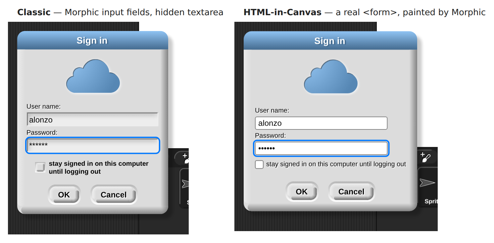
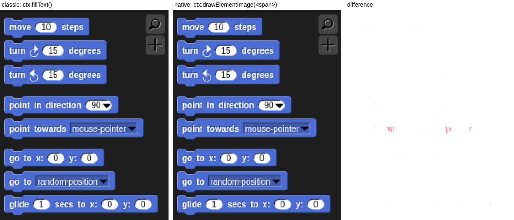
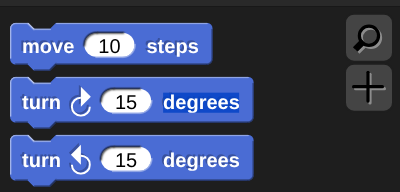

# HTML-in-Canvas and Snap! accessibility: an evaluation

*November 2026. Tested with Chrome 158 and Chrome for Testing 159 on
Linux, headless.*

[HTML-in-Canvas](https://github.com/WICG/html-in-canvas) lets a canvas lay
out its DOM children and paint them with `drawElementImage()`, while the
browser keeps their accessibility semantics, hit testing, focus and text
editing alive at the drawn position. It shipped in
[Chrome 157](https://developer.chrome.com/blog/html-in-canvas) in October 2026.

This document answers the questions in the ticket, using a working
prototype (`src/html-canvas.js`) and two demos built on real Snap!: the
cloud sign-in dialog and the text on blocks.

## Short answers

**Would Morphic still generate a parallel DOM?** Yes. Morphic stays the
scene graph and still creates one DOM node per morph it wants to expose.
What changes is where that tree lives and what some of its nodes do:

- The tree moves from an overlay beside the canvas into the canvas itself.
  This took about 30 lines and the whole existing a11y suite still passes.
- For text and form controls, the node stops being a hidden copy and
  becomes the thing that is painted and edited. The morph becomes a
  placeholder that reserves space and draws its element.
- For everything Morphic draws itself (block shapes, buttons, panes,
  sprites, the stage) nothing changes. Those still need role-and-name nodes
  that Morphic keeps in sync by hand.

**How does this change the accessibility work?** It does not replace it.
It removes one class of problem: anything where we imitate a native
control. The sign-in dialog is the clear win. Block text gains less than
expected.

**What should Morphic adopt?** An element-backed morph for forms and,
later, for text editing. Not native text for every label, at least not
yet. Details are in [Recommendations](#recommendations).

**The constraint that shapes everything:** this is Chromium-only today.
The overlay parallel DOM has to remain the baseline, so HTML-in-Canvas can
only ever be an enhancement on top of it. See
[Browser support](#browser-support).

## Trying it

The prototype is opt-in by URL and inert otherwise.

| URL | What it turns on |
|---|---|
| `snap.html?html-in-canvas` | everything below |
| `snap.html?html-in-canvas=forms` | HTML credential dialogs only |
| `snap.html?html-in-canvas=text` | native text on blocks only |
| `snap.html?html-in-canvas=text-all` | native text for every `StringMorph` |
| `snap.html?html-in-canvas#signup` | opens the Sign up dialog straight away |

`tests.html` links to these. In a browser without the API the flag does
nothing and Snap! renders the classic way.

To see the sign-in dialog: cloud button, then "Login...". Tests are in
`tests/specs/90-html-in-canvas.spec.js` (23 tests).

## The API as shipped

Five pieces, all on the canvas element or its 2D context:

1. `<canvas content="drawable">` makes canvas children take part in layout
   instead of being fallback content.
2. The `drawable` attribute marks a descendant as something that can be
   painted on its own.
3. `ctx.drawElementImage(element, x, y, w, h)` paints the browser's latest
   snapshot of that element under the current transform.
4. A `paint` event fires on the canvas when a drawable would look
   different. Its `changedElements` lists which ones.
5. `canvas.updateElementGeometry()` and `clearElementGeometry()` tell the
   browser where an element is, for hit testing and for assistive
   technology. `drawElementImage()` does this automatically in 2D.

Canvas descendants are in the accessibility tree like any DOM. An element
that has never been drawn is exposed without geometry.

## Demo 1: the sign-in dialog

`DialogBoxMorph.prototype.promptCredentials` builds the Sign in, Sign up,
Change password and Reset password dialogs. With the flag on, the dialog
body is an `HTMLMorph` holding a real `<form>`. The frame, title, cloud
icon and OK / Cancel buttons are still ordinary morphs.



What the browser's accessibility tree contains, classic versus
HTML-in-Canvas:

```text
classic parallel DOM                    HTML-in-Canvas
--------------------                    --------------
dialog "Sign in"                        dialog "Sign in"
  button "OK"                             form "Sign in"
  button "Cancel"                           textbox "User name:"
  textbox "Sign in"                         textbox "Password:"  (type=password)
  textbox "Sign in"                         checkbox "stay signed in on this
  checkbox "stay signed in..."                computer until logging out"
                                          button "OK"
                                          button "Cancel"
```

What changed for a user:

| | Classic | HTML-in-Canvas |
|---|---|---|
| Field names | both fields are called "Sign in" | each field has its own `<label>` |
| Reading order | buttons first | fields, then buttons |
| While typing | focus is on one shared hidden `<textarea>` | focus is on the field itself |
| Password | a plain text field as far as the browser knows | `type=password` with `autocomplete` hints |
| Caret, selection, IME | redrawn by `CursorMorph` | native |
| Birth month and year | Morphic drop-down menus | native `<select>` |
| Validation errors | a speech bubble, not announced | `role=alert`, `aria-invalid`, focus moves to the field |
| Terms of Service | a button that calls `window.open` | a link |

Keyboard behavior is the same as before and is tested: focus opens in the
first field, Tab runs through the native fields and then the Morphic
buttons and wraps, Shift+Tab enters the form at its last control, Enter
accepts, Escape cancels and returns focus to the opener.

The form also drives Morphic layout. When an error message appears, the
form grows, a `ResizeObserver` tells the morph, and the dialog lays itself
out again.

### A bug this turned up in the classic dialog

After the user left the password field, the classic parallel DOM exposed
the typed password in clear text as that textbox's content. This is fixed
in `InputFieldMorph.prototype.updateAccessibleElement`, which now exposes
bullets, and covered by a test. Two weaknesses remain and are worth fixing
regardless of HTML-in-Canvas:

- While typing, the password sits in the shared hidden textarea, which is
  a plain multi-line text field to a screen reader.
- Both fields take the dialog's name because nothing associates a field
  with the label above it.

## Demo 2: the text on a block

With the flag on, `BlockLabelMorph` and `InputSlotStringMorph` paint
through a `<span drawable>` instead of `fillText()`. Morphic still
measures with `measureText()` and still does all block layout, so block
geometry is unchanged.



What this gives:

- The words on blocks are real text nodes at their real positions.
  `window.find('degrees')` finds and highlights a block label, and the
  highlight is painted into the canvas.
- Each label's node is nested inside its block's node, so "move", "10" and
  "steps" are children of the `option` named "move steps".
- Rendering matches `fillText()` at 1× apart from antialiasing (2.4% of
  pixels differ, none by more than 22% in any channel). At 2× the native
  text sits one device pixel lower; adjusting line height and padding did
  not remove that.



What it does not give, today:

- **No change in what a screen reader says.** Blocks get their names from
  `aria-label`, which the a11y layer computes because it has to merge
  label parts and slot values in reading order. The root is
  `role=application`, so browse-mode text reading does not apply either.
- **No text selection with the mouse.** Labels are pointer-transparent so
  that blocks stay draggable.

What it would take to make it pay off: structure each block's node so its
accessible name comes from its content, in `parts()` order, with slots as
child nodes carrying their values. Then `blockAccessibleLabel` goes away
and names can never be stale. That is a change to the a11y layer's block
tagging and does not need HTML-in-Canvas, though native text makes it more
natural.

### Cost

Measured in headless Chrome 158 with software rendering, so read the
ratios, not the absolute numbers.

Synthetic, redrawing every label every frame:

| Labels | `fillText()` | `drawElementImage()` |
|---|---|---|
| 200 | 16.6 ms/frame | 16.7 ms/frame |
| 1000 | 16.7 ms/frame | 16.7 ms/frame |
| 3000 | 20.6 ms/frame | 37.4 ms/frame |

Real projects, full-world redraw:

| Project | Text elements | Classic | Native |
|---|---|---|---|
| CS10 SP22 Final Main | 372 | 22.5 ms/frame | 24.4 ms/frame |
| Snap! v11 Map Colors | 223 | 23.0 ms/frame | 24.8 ms/frame |

Idle cost is zero: no `paint` events fire when nothing changes. Creating
3000 elements took 18 ms and their first snapshot 96 ms.

So it is affordable at the sizes Snap! shows on screen, and about twice as
slow as `fillText()` once several thousand labels are redrawn per frame.

## What Morphic had to learn

Each item is a place where a canvas-first, damage-list renderer and this
API do not line up by themselves. All of it is in `src/html-canvas.js`
unless noted.

**1. A morph backed by an element (`HTMLMorph`).** The browser lays the
element out and the morph takes its extent from `offsetWidth` /
`offsetHeight`. This is synchronous, which matters because Morphic's
`fixLayout()` is synchronous. The element must be inside the canvas to be
laid out, so before the morph joins the world its element waits in an
inert parking node.

**2. The `paint` event is `changed()`.** `handleCanvasPaint` marks each
changed element's morph as damaged and calls `updateBroken()` at once.
Drawing done inside the `paint` event lands in the current frame, so a
caret blink or a typed character appears without a frame of delay.

**3. Two render paths, permanently.** An element can only be drawn into
the canvas it lives in. Drawing into any other canvas throws, including
through `captureElementImage()`. Morphic renders into offscreen canvases
all the time: `fullImage()`, drag images, drop shadows, script pictures,
export. So:

- `StringMorph.render` uses the element on the world canvas and
  `fillText()` everywhere else.
- `HTMLMorph` draws a placeholder offscreen.
- `HandMorph.grab` skips its cached bitmap when the grabbed morph contains
  an `HTMLMorph`, so a dialog is dragged live with its form visible.

**4. New or changed text needs one classic frame.** An element cannot be
drawn before the browser has taken a snapshot of it. New and restyled
labels are drawn with `fillText()` first; the `paint` event then repaints
them natively before that frame is shown.

**5. Pointer input needs arbitration.** A drawn element is hit-testable,
so the browser sends it the mouse events. Two rules:

- Morphic's canvas listeners call `isHTMLEvent()` first and stand aside
  for events aimed at a native control. This is seven one-line guarded
  hooks in `morphic.js`.
- The browser does not know which morphs are drawn on top of an element.
  On every mouse move the element's `pointer-events` is switched on only
  while its morph really is the topmost one under the pointer, and never
  during a drag. Without this a menu over the dialog could not be clicked.

**6. Keyboard needs one hook.** While focus is in a native control, the
a11y layer's key handler must leave typing, Space and Enter alone but
still see Escape and Tab at either end of the form. That is
`a11yNativeKey`, six lines in `accessibility.js`.

**7. Geometry needs housekeeping.** Drawing an element sets its position.
A morph that is scrolled out of view or hidden is not drawn, so its
element keeps claiming the old position. A sweep clears the geometry of
elements whose morphs are not showing and removes the elements of morphs
that left the world.

**8. Scaling needs an explicit size.** The default draw size is in canvas
pixels. Morphic already scales its context for high-density displays and
for its own zoom, so every draw passes the morph's width and height
explicitly. With that, both work, and the form stays sharp at Morphic
zoom 1.5 because the snapshot is a display list, not a bitmap.

### Things that were not obvious

- Only immediate children of the canvas are forced to `display: block`.
  A nested drawable `<span>` stays inline and ignores width, height and
  padding until it is given `display: block`.
- Drawables are forced to `position: static`. Where an element lays out
  is irrelevant; only its size matters.
- Only the border box is painted. A focus outline outside it is cut off,
  so the form has padding to hold its outlines.
- A never-painted drawable can still carry geometry. The whole overlay
  root became one drawable mapped onto the canvas with
  `updateElementGeometry()`, and every role-only node inside it kept the
  position it had before.
- System colors, spelling markers and some IME formatting are deliberately
  not painted, for privacy. Everything drawn has to be styled explicitly.

## Browser support

- **Chrome:** shipped in 157. All tests here ran on 158.
- **WebKit:** the standards-position issue
  ([#630](https://github.com/WebKit/standards-positions/issues/630)) had a
  comment in August 2026 saying it would be marked "support". Nothing has
  shipped in Safari.
- **Mozilla:** the standards-position issue
  ([#1076](https://github.com/mozilla/standards-positions/issues/1076)) has
  no position. Comments from Mozilla engineers in December 2025 and March
  2026 argue against the approach.

I read those two issues through a summarizing tool, not directly, so check
them before quoting.

Snap! is used on iPads and in Firefox. Whatever is built on this API needs
a classic path that is equally accessible, which is exactly what the
prototype's fallbacks are.

## Recommendations

**Keep the parallel DOM as the architecture.** HTML-in-Canvas does not
remove the need for it, and it is the only thing that works everywhere.

**Fix in the classic layer now, independent of this API:**

- Give each credentials field its own name by pairing it with the label
  above it.
- Put dialog fields before dialog buttons in the DOM.
- Announce validation errors through the live region.

**Adopt, behind feature detection:**

- `HTMLMorph` for dialogs that are forms. The credential dialogs are done.
  The next candidates are the ones with free text: project notes, and the
  multi-line fields in the block editor.
- Moving the parallel root into the canvas when the API exists. It is
  cheap and it is what lets painted elements nest in the right place.

**Investigate next:** native text *editing*. Replacing the hidden textarea
and `CursorMorph` with a real `<input>` drawn in place, for every
`world.edit()`, would fix IME, mobile keyboards and screen-reader echo in
block slots, the sprite name field and every dialog at once. It is the
largest potential gain and the largest change. The sign-in form shows the
mechanics work.

**Hold off:** native text for all block labels. It costs a second render
path and a DOM node per label, and changes nothing a screen reader says
until block nodes are restructured to take their names from content.

### Upstream footprint

| File | Change |
|---|---|
| `src/html-canvas.js` | new, about 1,300 lines with comments, everything opt-in |
| `src/morphic.js` | seven guarded `isHTMLEvent` calls in the canvas listeners |
| `src/accessibility.js` | the `a11yNativeKey` hook |
| `src/widgets.js` | password masking fix (not related to the API) |

## Not tested

- Real screen readers (VoiceOver, NVDA, JAWS). Everything here is verified
  through the accessibility tree and DOM, not through speech.
- Password manager and autofill UI. The `autocomplete` attributes are
  there; whether the browser offers to fill was not observed in headless.
- IME composition, mobile virtual keyboards, touch input. Touch is the
  weak point of the pointer arbitration, which relies on mouse moves.
- The browser's own find-in-page UI and Chrome Translate. Only
  `window.find()` was exercised. Translation would change text widths
  under Morphic's layout and is likely to break block geometry.
- A real GPU. All timings are from software rendering.
- Elements clipped by a scroll frame. Their hit area is not clipped
  (`canvasClip` is not used yet).
